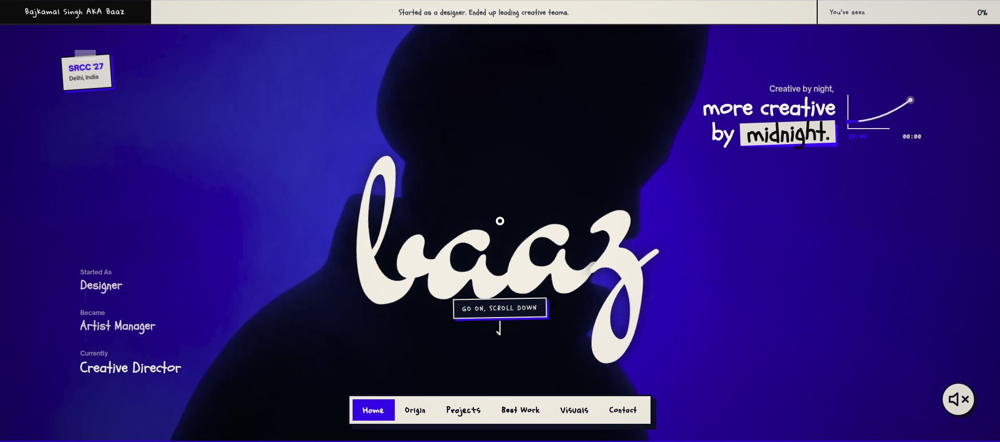
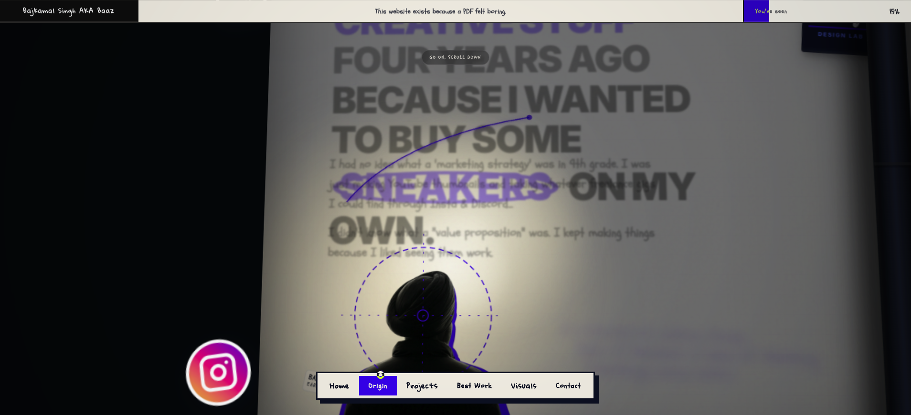
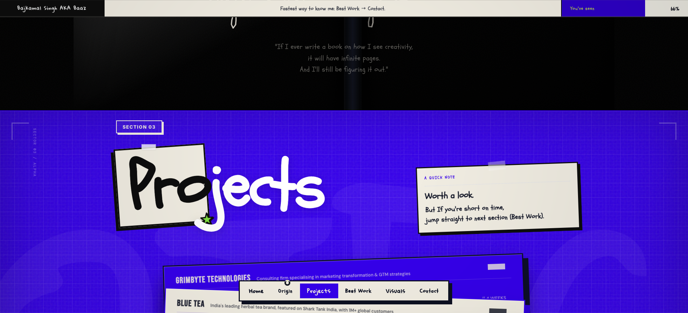
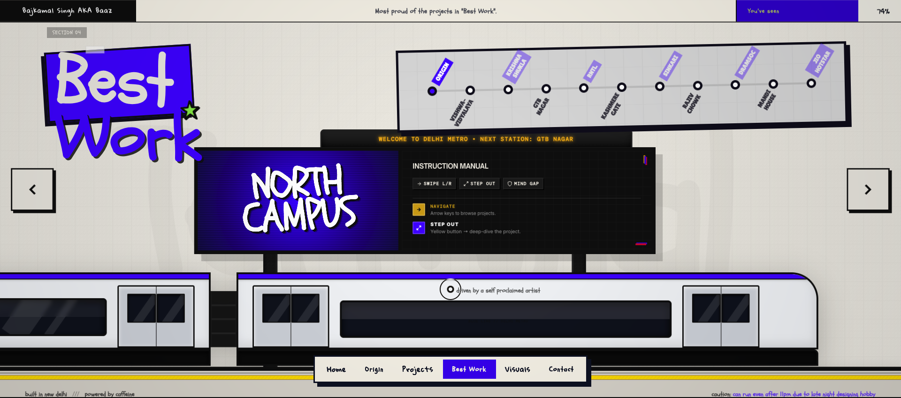
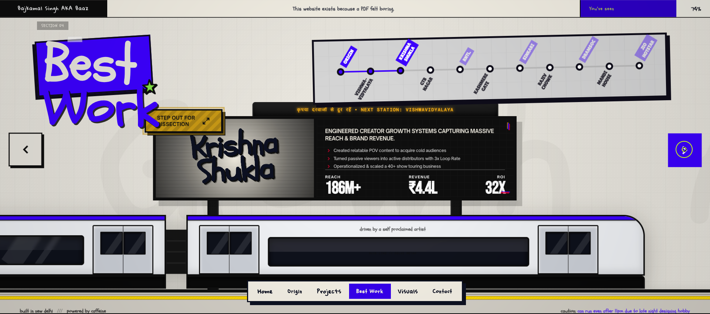
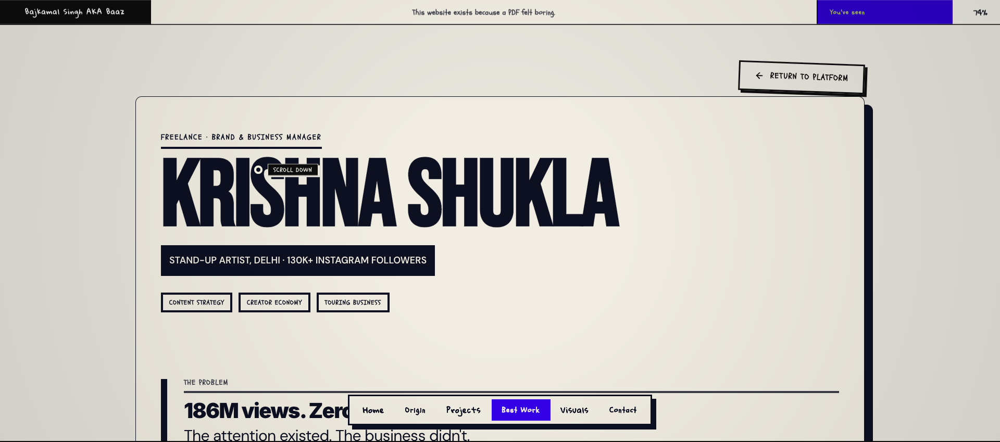
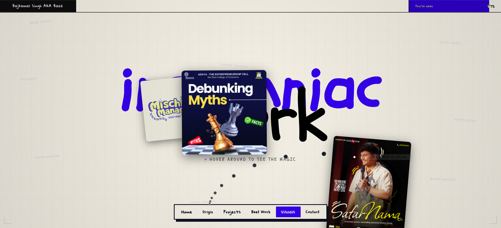
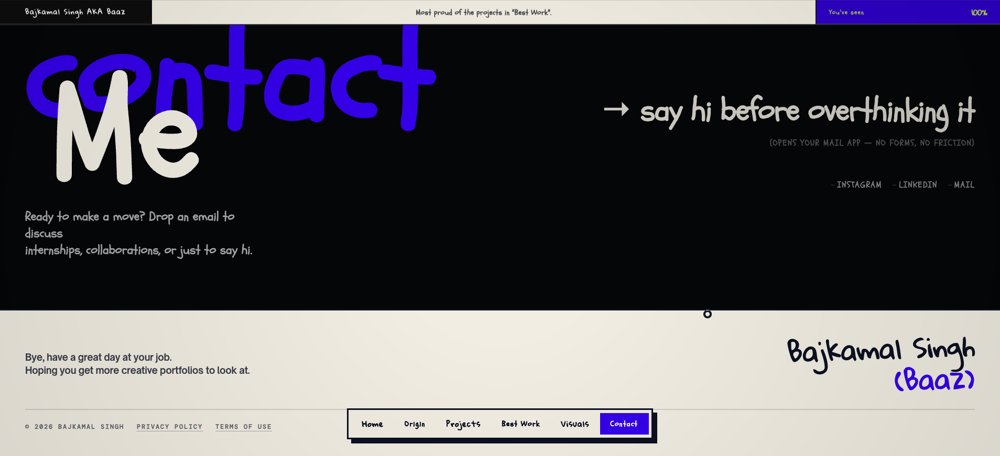

# Inspiration Canvas 03 — Baj Kamal Singh / Baaz + Portfolio Ideas PDF

- **Live URL**: [bajkamalsingh.me](https://bajkamalsingh.me/)
- **Primary Sources**: Attached 11-page PDF (`Portfolio-Ideas-II-Part-2-2026-06-07-09-16-38.pdf`) + verified static/runtime study in [`docs/reference-study/reference-mechanics.md`](../reference-study/reference-mechanics.md) and [`docs/reference-study/pdf-requirements.md`](../reference-study/pdf-requirements.md).
- **Role in V5**: **Storytelling Pacing, Tactile Personality & Anti-Pattern Guardrails** — how to make a portfolio emotionally memorable and recruiter-friendly while avoiding heavy-animation and mobile/accessibility traps.

---

## 1. Visual Section Gallery (Captured Live Reference Screenshots)

| Chapter | Desktop Reference Capture |
| --- | --- |
| **01. Hero** |  |
| **02. Origin / Diary Notebook** |  |
| **03. Projects / Experience Stack** |  |
| **04. Best Work — Metro Entry** |  |
| **05. Metro Project Billboard** |  |
| **06. Case Study Deep Dive** |  |
| **07. Visuals / Mouse-Trail Gallery** |  |
| **08. Contact Closing** |  |

---

## 2. Core Concept & Creative Hook ("The Plus Point")
- **Chapter-Based Physical World**: Instead of repeating card grids, each of the 6 sections changes the visitor's physical mode: **Watch** (Hero) → **Read** (Notebook) → **Scan** (Dossier Stack) → **Ride/Select** (Metro) → **Explore** (Visuals Trail) → **Act** (Calm Contact).
- **Zero Three.js Required for Depth**: Verified in `reference-mechanics.md` — the entire 3D depth is achieved with **HTML + CSS 3D transforms (`perspective: 1500px`) + SVG + video + 40-layer text-shadow + GSAP 3.12.2 (`ScrollTrigger`, `Draggable`) + Lenis 1.0.34 + Tone.js 14.8.49**.

---

## 3. Styling, Palette & Typography Tokens
Verified via [`reference-mechanics.md`](../reference-study/reference-mechanics.md):
- **Palette**: Warm Beige `#F4EFE6`, Dark Beige `#E5DFC8`, Electric Blue `#012CEB` / `#0F35FF`, Deep Navy `#051024`, Near-Black `#010204`, Action Yellow `#D4A017`, LED Amber `#FFB000`, Signal Red `#FF2A2A`.
- **Materiality**: 2px–3px ink borders, 4px–8px hard offset shadows, torn paper edges, tape, staples, ruled notebook lines, and slight intentional card tilts (`-2deg` / `+2deg`).
- **Functional Type Pairing**: Handwriting (`Dr Sugiyama`, `Schoolbell`, `Gloria Hallelujah`) for human voice; condensed display (`Teko`, `Bebas Neue`) for punchy headlines; mono (`DM Mono`) for system state; clean sans (`Inter`, `DM Sans`) for readable copy.

---

## 4. Section-by-Section Motion & Interaction Breakdown

1. **Intro & Hero**:
   - Synthetic 4.9s blur-to-sharp quote intro (`24px` blur → `0px`, `0.025s` char stagger, interactive Skip at `0.5s`).
   - Hero silhouette video + pointer-reactive parallax (`0.06` lerp) + 40 dynamic `text-shadow` depth layers + subtle hidden quote ribbon easter egg.
   - *PDF Bonus Idea*: Hidden dwell timer (1–2 min on page) that triggers a playful collaboration nudge (*"You've already spent more time here than most recruiters do on portfolios — let's collaborate"*).
2. **Origin Notebook (Scroll-Scrubbed Storytelling Engine)**:
   - Sticky `95vw × 90vh` open notebook with `ScrollTrigger` (`scrub: 2.2`).
   - A blue SVG route (sampled at 2,000 points) physically guides the eye across 11 narrative milestones while a camera zoom (`1.65x`–`1.80x`) and **proximity focus lens** (active fragment sharp, next at `0.22` opacity, passed at `0.5` opacity + `1px` blur, max defocus `7px`) control reading pace.
   - Ends by morphing the SVG route into a handwritten signature, plus draggable vinyl stickers (`1.15x` press scale, `0.4s` elastic release).
3. **Projects / Experience Dossier Stack**:
   - Overlapping cards (`95px` desktop stack gap) alternating `-2deg`/`+2deg`. Hover lifts `8px` + `1.02x` tilt; click expands to push siblings `320px` down and reveal metrics/bullets.
   - Includes a direct **"Skip ahead to Best Work"** shortcut for time-strapped recruiters.
4. **Best Work — Metro Station**:
   - User-triggered door slide (`1.5s power3.inOut`), `100vw` horizontal station travel (`3.5s sine.inOut`) with subtle train rattle (`0.04s` yoyo), and full-screen cover-wipe (`0.55s`) into bespoke per-project case studies.
5. **Visuals Gallery (Optional Discovery)**:
   - Desktop-only mouse-trail spawning artwork every `180px` of cursor travel (capped at 15 active items, fading out after `3.5s`). Intentionally hidden from forced eyeline — visitors explore only if curious.
6. **Calm Contact Closing**:
   - Strips away visual density completely: large warm heading, short copy, direct prefilled `mailto:` CTA with zero form friction.
7. **Opt-In Sound & Custom Cursor**:
   - Tone.js synthesized tactile sounds (hover tick, pop, paper rustle, lock, arrival) strictly **off by default** until toggled.

---

## 5. Scrapped Ideas from the PDF (Creative Fuel & Warnings)
From pages 3–9 of `Portfolio-Ideas-II-Part-2`:
- **Pin Board** (sticky notes pinned onto a notice board on click) — great for scrapbook/journal vibes.
- **Vending Machine** (drag coin into slot to dispense case-study cards) — *Warning*: repetitive clicking just to reach Project #5 hurts UX; always allow direct jumping.
- **Interactive Coin Scratch-Off** (use a coin cursor to scratch off a hidden word in the bio) — super fun micro-easter-egg!
- **Radar Timing Mini-Game** (click when red line enters target zone to decrypt a skill) — cool as an *optional* Lab/easter-egg, never gate core info behind it.
- **Wallet / Encrypted Dossier Pull-Out** (slide case-study card up out of a dark sleeve on hover/click) — strong tactile card pattern.
- **Folder Fan-Out** (hover closed folder → project cards fan out) — lightweight and accessible.
- **Frequency Radio Dial** (tune frequencies to surface cards + voiceover) — pairs nicely with Carter's `Dial` experiment!

---

## 6. Critical Guardrails from the PDF ("Honest Tips" — Non-Negotiable for V5)
1. **15–20 Second Recruiter Window**: Hook immediately with clear identity + give a fast shortcut to flagship work.
2. **Never Gate Access Behind Repetitive Clicks**: Visitors must be able to jump directly to Project #1 or #5 without loops.
3. **Mobile & Accessibility From Day 1**: Baj Kamal explicitly warns his site broke on mobile and lacked proper accessibility/reduced-motion handling due to heavy GSAP without media-query architecture. **V5 must design responsive + `prefers-reduced-motion` + keyboard navigation simultaneously with desktop.**
4. **Balance Creativity vs. Weight**: Don't over-animate every single button; reserve heavy choreography for hero moments and keep utility controls crisp and fast.
5. **Mockup Exact Proportions First**: Design section proportions, typography, and spacing explicitly before coding each section.
